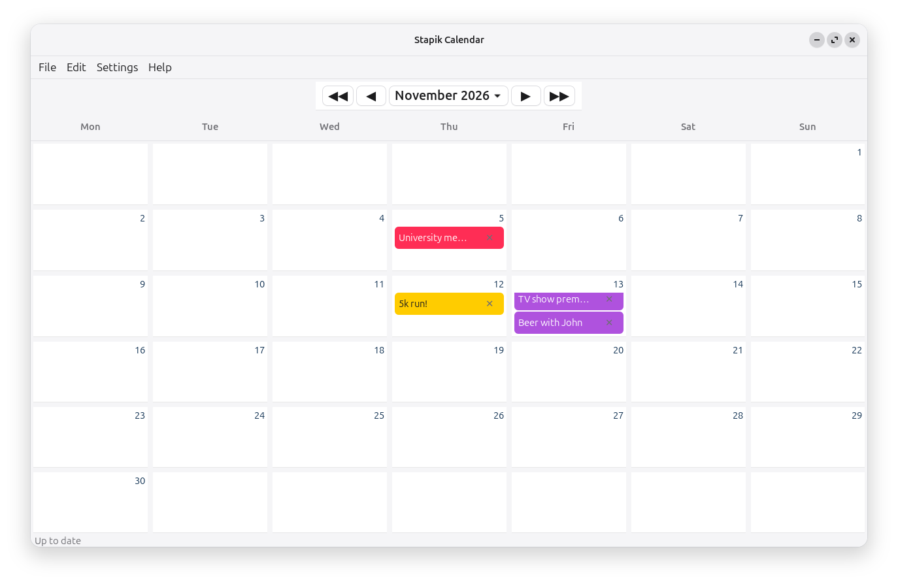

# Stapik Calendar

A desktop calendar application, written in C++20 using GTK4/gtkmm. Supports multiple visual themes, from a retro look to a modern one.



## Features

- **Monthly view** - calendar grid with month and year navigation, and a month picker to jump to any month; the week starts on the day set in the regional settings of the system and the weekend is always Saturday and Sunday
- **Week and day views** - switch between the month, a single week and a single day from the *View* menu (or `Ctrl+1`, `Ctrl+2`, `Ctrl+3`); the arrows then move by a month, a week or a day
- **Today button and selected day** - one click returns to the current day; the selected day is highlighted and stays the anchor while you move between months
- **Keyboard navigation** - arrow keys move the selected day, Page Up/Down change the month (with Ctrl the year), Home or Ctrl+T jumps to today, Enter or Ctrl+N adds an entry
- **Week numbers** - the number of each week next to the rows of the month (ISO 8601 for weeks starting on Monday, otherwise the week with 1 January is week 1); can be switched off in **Settings → Show week numbers**
- **Calendar entries** - add, edit and delete entries with a name, optional link, location, time and color; entries with a time are listed first, in the order of the clock
- **Entry links** - an entry that has a link shows a small link symbol; clicking it opens the link in the default browser (only `http` and `https` links; a link without a scheme is opened as `https://`), while a single click on the entry name opens the entry for editing
- **Entry colors** - assign one of ten shared category colors to an entry, either from the entry dialog or via a quick right-click popover on an existing entry
- **Drag and drop** - drag an entry to another day to move it; hold **Ctrl** while dragging to copy it instead
- **Quick add from clipboard** - right-clicking a day while a URL is in the clipboard opens the new entry window with the link filled in
- **Undo/Redo** - operation history for adding, editing, deleting, moving and copying entries (up to 100 steps), with the operation named in the menu and `Ctrl+Z` / `Ctrl+Shift+Z` shortcuts
- **Cloud sync** - background synchronization with an external API (compatible with a self-hosted server), one cloud partition per year loaded as you navigate, automatic retries when offline, conflict resolution based on timestamps and a sync status indicator
- **Tutorial** - **Help → Tutorial** (or `F1`) opens an illustrated tutorial in its own window, with a table of contents, in Polish, English or German
- **Multilingual UI** - Polish, English and German interface with instant switching
- **Themes** - switch between **Classic** (retro), **Neoclassic** (a softer, take on the classic look), **Modern** (light, rounded), **Dark** (the modern look on a dark palette) and **Classic Pink** (classic layout with a vaporwave pink/purple/cyan palette) from the settings window; the choice is remembered between launches
- **Settings window** - **Settings → Settings…** opens one window with the language, the theme and the font (a family and a size, picked in the system font chooser); a change is applied and saved at once
- **Window memory** - the size, the position and the maximized state of the window are remembered between launches (the position is not remembered on Wayland)
- **Single instance** - starting the program again shows the running window instead of opening another one
- **Update notice** - once a day the application asks GitHub for the latest release and, when it is newer than the one you run, offers to open its page; nothing is downloaded or installed. It can be switched off in **Settings → Settings…**
- **Command line** - `--version`, `--portable`, `--data-dir`, `--safe-mode`, `--reset-settings` and `--log-level`, see [Command line](#command-line)
- **Auto-save** - calendar data saved locally after every change in one file per year, atomically and with rotating backups; if a save fails, a message tells you why
- **Backup of the whole application** - **File → Back up the whole application…** saves the calendar together with the settings into one `.zip` file, and **File → Restore the whole application…** brings both back from such a file, for example on another computer
- **Restore from backup** - **File → Restore from backup…** lists the saved copies of the displayed year by date and time and goes back to the one you pick; the year you had before becomes the newest copy, so a restore can be taken back the same way

## Dependencies

- `gtkmm-4.0` and `sigc++-3.0`
- `libcurl`, `libsodium` and `zlib` (required by `stapik-common`)
- `libsecret` and `libx11` (Linux, optional: the cloud API key is kept in the system keyring and the window position is remembered)
- CMake 4.2 or newer
- [`stapik-common`](https://github.com/Stapik-Group/stapik-common) 1.6.0 (fetched automatically via CMake FetchContent) - it provides the application framework: settings, localization, themes, menu, undo stack, document storage and cloud sync
- `nlohmann/json` (fetched automatically via CMake FetchContent, transitively provided by `stapik-common`)

On Ubuntu/Debian:
```bash
sudo apt install libgtkmm-4.0-dev libcurl4-openssl-dev libsodium-dev zlib1g-dev libsecret-1-dev libx11-dev
```

Building a `.deb` package additionally requires `dpkg-dev` (used to auto-detect runtime dependencies):
```bash
sudo apt install dpkg-dev
```

## Building

```bash
git clone https://github.com/Stapik-Group/stapik-calendar
cd stapik-calendar
cmake -B cmake-build-release -DCMAKE_BUILD_TYPE=Release
cmake --build cmake-build-release
```

## Installation

### Option 1 — Download prebuilt `.deb` (recommended)

Download the latest `.deb` package for your distribution (Ubuntu 24.04 or Debian 13; the name ends with the distribution) from the [Releases page](https://github.com/Stapik-Group/stapik-calendar/releases), then install it:

```bash
sudo dpkg -i stapikcalendar_*.deb
sudo apt install -f   # resolves any missing runtime dependencies
```

### Option 2 — build `.deb` from source

If you'd rather build the package yourself:

```bash
cd cmake-build-release
cpack -G DEB
sudo dpkg -i stapikcalendar_*.deb
sudo apt install -f
```

Either option installs the app to `/opt/stapikcalendar/` (binary, resources and shared `stapik-common` resources), with a launcher at `/usr/bin/stapikcalendar`, a desktop entry `pl.stapik.calendar.desktop` and an icon, so it appears in the desktop environment's application menu.

### Option 3 — per-user install (no sudo required)

The launcher records the installation prefix at configure time, so set both prefixes when configuring:

```bash
cmake --install cmake-build-release --prefix "$HOME/.local"
```

Installs to `~/.local/lib/stapikcalendar/`, with a launcher at `~/.local/bin/stapikcalendar`. Make sure `~/.local/bin` is in your `PATH`.

### Option 4 — Flatpak or AppImage (built from source)

```bash
cmake --build cmake-build-release --target stapikcalendar_flatpak     # needs flatpak-builder
cmake --build cmake-build-release --target stapikcalendar_appimage    # needs linuxdeploy and its GTK plugin on PATH
```

The Flatpak is created in `cmake-build-release/stapikcalendar-flatpak/`, the AppImage in `cmake-build-release/stapikcalendar-appimage/`. Both are described in the [stapik-common documentation](https://github.com/Stapik-Group/stapik-common/blob/v1.6.0/docs/linux.md).

## Uninstalling

### If installed via `.deb`

```bash
sudo dpkg -r stapikcalendar
```

### If installed per-user

```bash
rm -rf ~/.local/lib/stapikcalendar
rm ~/.local/bin/stapikcalendar
rm ~/.local/share/applications/stapikcalendar.desktop
rm ~/.local/share/icons/hicolor/256x256/apps/stapikcalendar.png
```

Either way, your calendar data and settings remain in `~/.local/share/stapikcalendar/` and `~/.config/stapikcalendar/` — see [Data Storage](#data-storage) below if you want to remove those too.

## Cloud Sync

The app supports synchronization via a self-hosted [Stapik Cloud](https://github.com/Stapik-Group/stapik-cloud) server (or any other with compatible api [Stapik Cloud API](https://github.com/Stapik-Group/stapik-cloud/blob/master/backend/src/main/resources/openapi/app-api.yaml)). The server must be Stapik Cloud **1.2.0 or newer**; older servers are not supported. Go to **File → Connect**, enter the server URL and the API key issued for this specific device (generated per-device from the Stapik Cloud admin panel — there is no shared or global key, and each device gets its own, independently revocable). To stop synchronizing, use **File → Disconnect from cloud**: it removes the saved address, key and passphrase from this device and leaves the calendar untouched.

Once connected, the app compares the local document and the cloud copy using a timestamp and keeps whichever one is newer, overwriting the other **as a whole document**. Each year of the calendar is its own cloud partition (`2026`, `2027`, ...), so the comparison happens per year; the displayed year is loaded at once and the others when you navigate to them. There is no field-level or entry-level merging — if both copies changed since the last sync, the write that's based on the older cloud state loses.

Unlike the original simple sync protocol, a losing write isn't necessarily gone for good. Each cloud document slot has a conflict-resolution strategy set in the admin panel:
- **Last-write-wins with shadow copy** (the default) — the losing write is kept in the document's version history and can be restored from the admin panel.
- **Last-write-wins** — the losing write is discarded, matching the original behavior.

Data is saved locally after every change. Synchronization runs in the background, so it never blocks the window: a change is pushed to the cloud about 1.5 seconds after the last edit, and pending changes are flushed when you close the window. If the cloud is unreachable, the change stays saved locally and the app retries automatically with an increasing delay (from 2 seconds up to 5 minutes) — no data is lost, but the cloud copy lags behind until a write succeeds. A status indicator at the bottom of the window (shown only when a cloud is configured) tells whether the calendar is up to date, syncing, offline, in conflict or failed. You can also trigger a sync manually from **File → Sync**.

When the server version wins a conflict, it replaces the local document and the undo history is cleared, because earlier operations no longer match the data.

API keys may have an expiry date. When the key is within its last 30 days, the cloud reports it and the app shows a message with the date, once per reported date, so you can issue a new key in the admin panel and enter it in **File → Connect** before sync stops. If the server asks the app to slow down (at most 600 requests per minute per key), the local calendar is kept and the next attempt waits as long as the server asked.

**Upgrading from versions with a single cloud document:** earlier versions kept the whole calendar in the document `calendar.json`. The first time the app connects to a cloud it reads that document once (never writing to it) and adds its entries to the years on this device; the setting `cloud.legacyMigratedFor` remembers that this was done. The old document stays as it is, but it is no longer updated, so older versions on other devices keep using it and do not see the partitions.

**Upgrading from 1.1.x:** version 1.2.0 changed the document format stored in the cloud (the timestamp is now part of the synchronized document). Upgrade every device before connecting any of them to the same cloud slot — a 1.1.x client cannot read the new format and would treat the cloud document as empty. A cloud document written by 1.1.x is still read by 1.2.0 and is replaced with the new format on the next successful write.

**Caution for multi-device use:** editing the calendar offline on two different machines before either one reconnects can still cause one set of changes to lose the conflict. With shadow-copy resolution (the default), that copy isn't destroyed — it's recoverable from the admin panel's version history — but it won't reappear in the app on its own; recovering it means restoring it from the admin panel and syncing again. If you use the app on more than one device, sync (or at least go online) after each editing session to avoid needing a manual restore.

### API

The app talks to a Stapik Cloud server (or any server implementing the same contract):

- `GET /api/v1/documents/{slotKey}` — returns `{ "slotKey": "...", "content": "...", "contentHash": "...", "updatedAt": "..." }`
- `GET` / `PUT /api/v1/documents/{slotKey}/partitions/{year}` — the same for one year (`2026`), and `GET /api/v1/documents/{slotKey}/partitions` lists the years that exist; the calendar uses only these, the document itself (`{slotKey}`) is read once to import a calendar saved by an earlier version
- `PUT /api/v1/documents/{slotKey}` — accepts `{ "content": "...", "clientLastKnownUpdate": "..." }`, returns the same shape as `GET`. Status `200` means the write was accepted; `409` means it lost a conflict (the write carries the version it is based on in `If-Match`; a missing or stale one loses), and the response body is the current, winning document rather than an echo of what was sent.

Authentication: `x-api-key` header with a per-device key from the admin panel. The old `/read`/`/write` endpoints and the single shared API key are no longer supported — existing installations need to be reconnected in **File → Connect** with a newly issued key.

## Command line

| Flag                | Effect                                                                                                           |
|---------------------|------------------------------------------------------------------------------------------------------------------|
| `--version`         | Prints the name and the version and exits.                                                                       |
| `--log-level=LEVEL` | `debug`, `info`, `warning` or `error`. Overrides `STAPIK_LOG_LEVEL`.                                             |
| `--data-dir=DIR`    | Keeps data, settings and cache in `DIR/{data,config,cache}`.                                                     |
| `--portable`        | Same as `--data-dir`, with a `portable/` folder next to the executable. Cannot be combined with `--data-dir`.    |
| `--reset-settings`  | Moves `settings.json` (and the old `locale.txt` and `theme.txt`) aside as `*.bak` before the application starts. |
| `--safe-mode`       | The window size and position are neither restored nor saved.                                                     |
| `--self-test`       | Checks the installation (see [Windows](#windows)) and exits with 1 when a check fails.                           |

## Data Storage

Calendar data is stored locally in `~/.local/share/stapikcalendar/`, one file per year (`calendar-2026.json`, `calendar-2027.json`, ...), each a versioned document with the entries of that year:

```json
{
  "schemaVersion": 1,
  "document": {
    "lastUpdate": "2026-10-04T12:00:00Z",
    "entries": [ { "date": "2026-10-04", "name": "...", "link": "...", "color": "teal", "location": "...", "time": "14:30" } ]
  }
}
```

Each entry stores a name, an optional link, an optional location, an optional time (`HH:MM`) and a color id (`default`, `red`, `orange`, `yellow`, `green`, `teal`, `blue`, `purple`, `pink`, `brown` or `gray`). Files written by older versions (a bare entries array, or the `lastUpdate` / `payload` envelope) are migrated automatically on the first start. The single `calendar.json` of earlier versions is split into the year files once and kept as `calendar.json.migrated`.

Next to it:

- `calendar-YYYY.json.bak`, `.bak.2`, `.bak.3` - the three previous versions of each year, rotated on every save of that year
- `calendar-YYYY.json.corrupt-<timestamp>` - a file that could not be parsed, moved aside so it is never overwritten
- `calendar-YYYY.json.unreadable-<timestamp>` - a copy of a file written by a newer version of the app (or one that failed to migrate); that year starts empty instead of the original being touched
- `cloud-baselines.json` - the cloud timestamp of each year this device last synchronized with (local sync state, never uploaded)

Language, theme and font preferences are stored in `~/.config/stapikcalendar/settings.json`; the `locale.txt` and `theme.txt` files of earlier versions are imported on the first start. The window state and the update check (`update.checkEnabled`, `update.lastCheck`) are kept in the same file.

The cloud configuration is in `~/.config/stapikcalendar/config.json` (server URL). The API key is kept in the system keyring (Secret Service on Linux, Credential Manager on Windows) and only stays in `config.json` (permissions 0600) when no keyring is available, which the app points out after connecting. When the keyring exists but cannot be read (for example when it is locked), the app says so at startup instead of connecting silently. Earlier versions kept `config.json` in the data directory; it is moved to the configuration directory on the first start.

## Architecture

```
src/
  application/   CalendarController - owns the document, undo history, local storage and the cloud session (no widgets)
  core/          model (CalendarDocument, CalendarEntry), commands (ICommand) and utilities
  infrastructure/storage/   CalendarDocumentStore - versioned, atomic persistence with backups and migration
  ui/            window, views, dialogs and widgets; views only read from the controller and report user intents
```

Shared building blocks (settings, localization, themes, menu, dialogs, undo stack, document file, cloud session) come from [`stapik-common`](https://github.com/Stapik-Group/stapik-common).

## Continuous integration

GitHub Actions call the reusable workflows of [stapik-common](https://github.com/Stapik-Group/stapik-common/blob/v1.6.0/docs/ci.md) (pinned to `v1.6.0`, like the dependency):

- a pull request from `develop` into `master` builds the application on Linux (in a Docker image) and on Windows (`.github/workflows/pull-request.yml`),
- nothing runs on pushes to a branch or on a merge into `master`,
- publishing a release, which creates its tag, builds and attaches a `.deb` for Ubuntu 24.04 and Debian 13, the Windows installer and the portable ZIP (`.github/workflows/release.yml`). The version of the packages is `VERSION` in `CMakeLists.txt`, so bump it before the release is created. The Windows files are signed when the repository has the secrets `WINDOWS_SIGN_PFX_BASE64` and `WINDOWS_SIGN_PFX_PASSWORD`.

## Windows

The Windows build is a folder with the program and everything it needs (GTK, its data, the application resources). It is distributed as an installer and as a portable ZIP, both attached to every release:

- `stapikcalendar-<version>-setup.exe` installs for the current user (or for all users on request), in English, Polish or German, with a Start menu entry, and every release upgrades the previous one. Uninstalling leaves your calendar and settings alone.
- `stapikcalendar-<version>-windows-portable.zip` needs no installation: extract the whole folder and start `stapikcalendar.exe`. To keep the data, settings and cache next to the program, start it with `--portable`.

Unsigned files make Windows show "Windows protected your PC" (SmartScreen): click "More info", then "Run anyway".

**Locally**, in an MSYS2 UCRT64 shell (packages: `gcc cmake ninja pkgconf gtkmm-4.0 curl libsodium zlib adwaita-icon-theme hicolor-icon-theme`, prefixed `mingw-w64-ucrt-x86_64-`; the installer also needs Inno Setup 6.3 or newer):

```
cmake -S . -B build -G Ninja -DCMAKE_BUILD_TYPE=Release
cmake --build build --target stapikcalendar_windows_bundle      # the folder build/stapikcalendar-windows/
cmake --build build --target stapikcalendar_windows_portable    # the ZIP
cmake --build build --target stapikcalendar_windows_installer   # the installer
```

Add `-DSTAPIK_WINDOWS_CONSOLE=ON` to keep a console window.

Data lives in `%APPDATA%\stapikcalendar\data\calendar-YYYY.json` (one file per year), settings in `%APPDATA%\stapikcalendar\config` and the log
(stderr of the GUI program) in `%LOCALAPPDATA%\stapikcalendar\cache\stapik.log`. To back up, copy the `calendar-*.json` files.

`--self-test` is also available on Linux; it checks icons, GSettings schemas, resources, the tutorial, translations and a
writable data directory, logs every check and exits with 1 when one of them fails.
