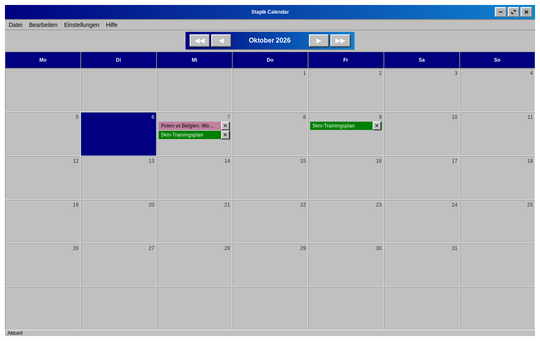

# Erste Schritte

Stapik Calendar ist ein Desktop-Kalender. Er zeigt jeweils einen Monat an, und jeder Tag kann beliebig viele **Einträge** enthalten. Ein Eintrag hat einen Namen, einen optionalen Weblink und eine optionale Farbe.

Alles, was Sie tun, wird automatisch auf Ihrem Computer gespeichert. Wenn Sie einen eigenen Stapik-Cloud-Server haben, kann der Kalender außerdem zwischen allen Ihren Geräten synchronisiert werden (siehe [Synchronisierung mit Stapik Cloud](#cloud)).

Ein kurzer Einstieg:

1. Starten Sie die Anwendung über Ihr Anwendungsmenü (*Stapik Calendar*). Sie öffnet sich im aktuellen Monat.
2. Doppelklicken Sie auf eine leere Stelle eines beliebigen Tages.
3. Geben Sie einen Namen ein und klicken Sie auf **OK**. Der Eintrag erscheint an diesem Tag.
4. Klicken Sie mit der rechten Maustaste auf den Eintrag, um ihm eine Farbe zu geben, ziehen Sie ihn auf einen anderen Tag, um ihn zu verschieben, oder klicken Sie auf **✕**, um ihn zu löschen.

