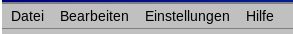

# Das Hauptfenster

Das Fenster besteht von oben nach unten aus:

- **Menüleiste** — *Datei*, *Bearbeiten*, *Einstellungen* und *Hilfe* (siehe [Menüs](#menus)).
- **Navigationsleiste** — der Name des angezeigten Monats und Jahres mit Schaltflächen zum Wechseln.
- **Wochentagszeile** — die sieben Wochentage. Die Woche beginnt an dem Tag, der in den Regionaleinstellungen Ihres Systems festgelegt ist (in den meisten europäischen Ländern Montag).
- **Tageszellen** — eine Zelle pro Tag. Die Tagesnummer steht in der Ecke der Zelle, der heutige Tag ist hervorgehoben. Zellen außerhalb des angezeigten Monats bleiben leer.
- **Statusleiste** — wird nur angezeigt, wenn der Kalender mit einer Cloud verbunden ist; sie zeigt den Synchronisierungsstatus (siehe [Synchronisierung mit Stapik Cloud](#cloud)).

