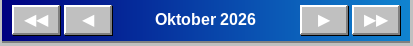

# Zwischen Monaten wechseln

Die Navigationsleiste hat vier Schaltflächen rund um den Monatsnamen:

- ◀ — voriger Monat
- ▶ — nächster Monat
- ◀◀ — voriges Jahr (gleicher Monat)
- ▶▶ — nächstes Jahr (gleicher Monat)

Der Monatsname zwischen den Schaltflächen ist ebenfalls eine Schaltfläche: Klicken Sie darauf, um einen kleinen Kalender zu öffnen und direkt zu einem beliebigen Monat und Jahr zu springen.

Die Schaltfläche **Heute** neben den Pfeilen führt zum aktuellen Tag zurück. Der zuletzt angeklickte Tag ist mit einem Rahmen hervorgehoben; beim Wechsel zwischen Monaten bleibt der Tag des Monats nach Möglichkeit erhalten.

Die Anwendung startet immer im aktuellen Monat. Einträge werden für jeden Monat und jedes Jahr gespeichert, ohne Begrenzung.

