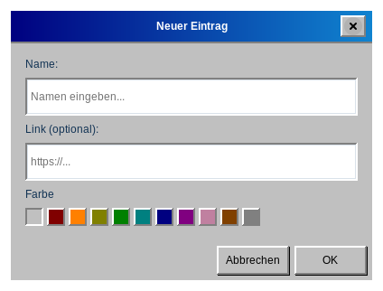
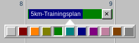
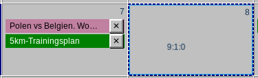
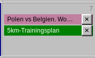

# Einträge

## Einen Eintrag hinzufügen

Doppelklicken Sie auf eine leere Stelle einer Tageszelle. Das Fenster **Neuer Eintrag** öffnet sich:

- **Name** — erforderlich. Ohne Namen wird der Eintrag nicht angelegt.
- **Link (optional)** — eine Webadresse, die Sie später mit einem Klick öffnen können.
- **Farbe** — das erste, leere Quadrat bedeutet keine Farbe; die übrigen sind Farben (siehe *Farben*).

Bestätigen Sie mit **OK** oder wählen Sie **Abbrechen**, um zu verwerfen.

## Schnell aus der Zwischenablage hinzufügen

Wenn Sie eine Webadresse kopiert haben (beginnend mit `http://` oder `https://`), klicken Sie mit der **rechten Maustaste** auf einen Tag. Das Fenster **Neuer Eintrag** öffnet sich sofort mit der Adresse im Feld **Link**, und die Anwendung lädt den Titel der Webseite und trägt ihn in das Feld **Name** ein. Dafür ist eine Internetverbindung nötig; kann der Titel nicht gelesen werden, geben Sie den Namen selbst ein. Bestätigen Sie mit **OK**. Enthält die Zwischenablage keine Webadresse, passiert nichts.

## Einen Link öffnen

Hat ein Eintrag einen Link, erscheint an seinem rechten Rand, neben der Schaltfläche **✕**, ein kleines Link-Symbol (↗). **Klicken Sie auf dieses Symbol**, um den Link im Standardbrowser zu öffnen. Der Mauszeiger wird darüber zu einer Hand, und beim Verweilen wird die Adresse angezeigt. Einträge ohne Link haben kein Symbol.

> Es werden nur `http`- und `https`-Links geöffnet. Ein Link ohne Schema, etwa `example.com`, wird als `https://example.com` geöffnet.

## Einen Eintrag bearbeiten

**Klicken Sie einmal auf den Namen eines Eintrags**, um das Fenster **Eintrag bearbeiten** zu öffnen, in dem Sie Name, Link und Farbe ändern können.

## Einen Eintrag löschen

Klicken Sie auf die Schaltfläche **✕** am rechten Rand des Eintrags. Ein gelöschter Eintrag lässt sich mit [Rückgängig](#undo-redo) zurückholen.

## Farben

Klicken Sie mit der rechten Maustaste auf einen Eintrag, um eine Reihe von Quadraten zu öffnen, und klicken Sie auf die gewünschte Farbe. Die Farbe können Sie auch in den Fenstern Neuer Eintrag und Eintrag bearbeiten wählen. Verfügbare Farben: Rot, Orange, Gelb, Grün, Türkis, Blau, Lila, Rosa, Braun und Grau sowie das Standardaussehen ohne Farbe.

## Verschieben und Kopieren

Ziehen Sie einen Eintrag und lassen Sie ihn auf einem anderen Tag los, um ihn zu **verschieben**. Halten Sie beim Ziehen `Strg` gedrückt, um ihn stattdessen zu **kopieren**. Wird ein Eintrag auf seinem eigenen Tag losgelassen, ändert sich nichts.

## Tage mit vielen Einträgen

Hat ein Tag mehr Einträge, als in die Zelle passen, lässt sich die Zelle scrollen. Ein kleines Symbol in der Ecke der Zelle (▲ oder ▼ mit einer Zahl) zeigt, wie viele Einträge oberhalb oder unterhalb verborgen sind; mit Mausrad oder Touchpad scrollen Sie dorthin. Die Einträge erscheinen in der Reihenfolge, in der Sie sie hinzugefügt haben.

