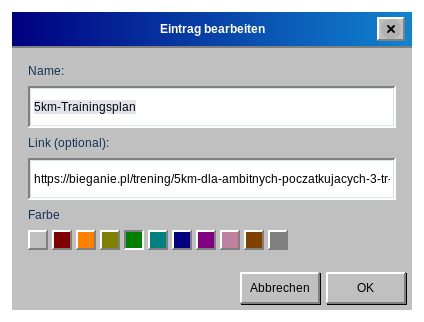

# Rückgängig und Wiederholen

Hinzufügen, Bearbeiten (auch das Ändern der Farbe), Löschen, Verschieben und Kopieren von Einträgen lassen sich rückgängig machen. Verwenden Sie **Bearbeiten → Rückgängig** und **Bearbeiten → Wiederholen** oder die Tastenkürzel `Strg`+`Z` und `Strg`+`Umschalt`+`Z`.

Der Menüeintrag nennt die Aktion, zum Beispiel *Rückgängig: Eintrag „Zahnarzt“ löschen*, und ist ausgegraut, wenn es nichts rückgängig zu machen oder zu wiederholen gibt. Der Verlauf umfasst bis zu 100 Schritte. Er wird beim Schließen der Anwendung nicht gespeichert und geleert, wenn die Version aus der Cloud Ihren lokalen Kalender ersetzt (siehe [Synchronisierung mit Stapik Cloud](#cloud)).

