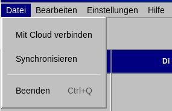
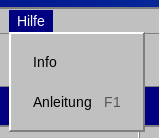

# Menüs

**Datei**

- Mit Cloud verbinden — Öffnet das Fenster zum Verbinden mit Stapik Cloud.
- Synchronisieren — Synchronisiert sofort mit der Cloud.
- Von der Cloud trennen — Beendet die Synchronisierung und entfernt die gespeicherte Adresse, den API-Schlüssel und die Passphrase von diesem Computer. Nur verfügbar, wenn eine Verbindung besteht.
- Aus Sicherung wiederherstellen… — Zeigt die gespeicherten Kopien des Kalenders nach Datum und Uhrzeit und kehrt zu der gewählten zurück. Der bisherige Stand wird zur neuesten Kopie, die Wiederherstellung lässt sich also auf demselben Weg zurücknehmen. Der Rückgängig-Verlauf wird geleert, und bei bestehender Verbindung wird der wiederhergestellte Kalender in die Cloud gesendet.
- Beenden `Strg`+`Q` — Schließt die Anwendung. Ausstehende Änderungen werden zuvor an die Cloud gesendet.

**Bearbeiten**

- Rückgängig `Strg`+`Z` — Macht die letzte Aktion rückgängig.
- Wiederholen `Strg`+`Umschalt`+`Z` — Wiederholt eine rückgängig gemachte Aktion.

**Einstellungen**

- Einstellungen… — Öffnet das Einstellungsfenster mit Sprache (Polnisch, Englisch oder Deutsch), Thema und Schriftart. Eine Änderung wirkt sofort.

**Hilfe**

- Anleitung `F1` — Öffnet diese Anleitung in einem eigenen Fenster mit dem Inhaltsverzeichnis links.
- Protokoll anzeigen — Zeigt das Anwendungsprotokoll, das beim Melden eines Problems hilft.
- Info — Zeigt Version und Autor der Anwendung.

