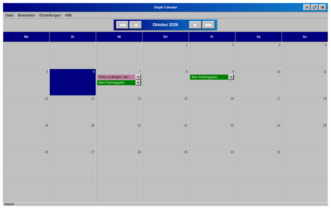
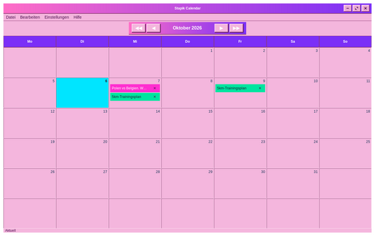
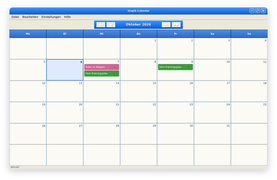
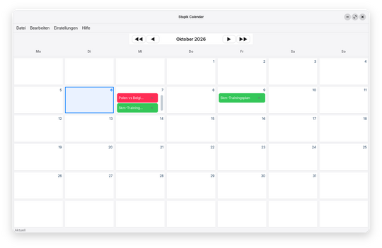
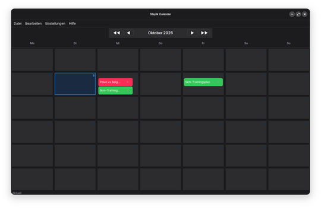

# Sprache und Thema

Wählen Sie **Einstellungen → Einstellungen…**, um das Einstellungsfenster zu öffnen. Jede Änderung wirkt und wird sofort gespeichert und beim nächsten Start der Anwendung beibehalten.

**Sprache** wechselt zwischen Polnisch, Englisch und Deutsch. Die gesamte Anwendung ändert sich sofort, einschließlich der Namen der Monate und Wochentage.

**Thema** ändert das Aussehen: **Klassisch** (ein Retro-Look), **Klassisch Pink** (dasselbe Layout in Rosa und Lila), **Neoklassisch**, **Modern** (hell) oder **Dunkel**.

**Schriftgröße (%)** skaliert den Text der gesamten Anwendung von 70 % bis 200 %. Standard sind 100 %.

