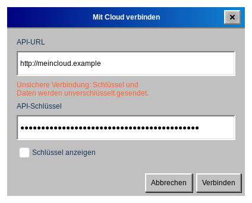
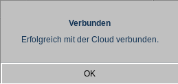

# Synchronisierung mit Stapik Cloud

Stapik Cloud ist ein Server, den Sie selbst betreiben. Er hält eine Kopie Ihres Kalenders vor, sodass alle Ihre Computer dieselben Einträge zeigen. Die Cloud ist optional — ohne sie arbeitet der Kalender einfach auf einem Computer.

## Was Sie brauchen

- Einen laufenden Stapik-Cloud-Server, den Ihr Computer erreichen kann, und dessen **Adresse** (die API-URL), zum Beispiel `https://cloud.example.com`.
- Einen für dieses Gerät ausgestellten **API-Schlüssel**. Im Admin-Panel von Stapik Cloud erhält jedes Gerät einen eigenen Schlüssel; es gibt keinen gemeinsamen Schlüssel.

Der Kalender wird auf dem Server im Dokument mit dem Namen `calendar.json` gespeichert.

## Verbinden

1. Wählen Sie **Datei → Mit Cloud verbinden**.
2. Geben Sie die **API-URL** ein. Sie muss mit `http://` oder `https://` beginnen.
3. Geben Sie den **API-Schlüssel** ein. Setzen Sie ein Häkchen bei **Schlüssel anzeigen**, wenn Sie prüfen möchten, was Sie eingegeben haben.
4. Klicken Sie auf **Verbinden**.
5. Nach einem Moment meldet eine Nachricht, ob die Verbindung funktioniert hat (*Verbunden*) oder nicht (*Verbindung fehlgeschlagen*, mit dem Grund).

> Beginnt die Adresse mit `http://`, warnt das Fenster, dass die Verbindung nicht sicher ist: Schlüssel und Kalender werden unverschlüsselt gesendet. Verwenden Sie `https://`, wenn der Server über das Internet erreichbar ist.

Die Einstellungen werden gespeichert. Beim nächsten Start verbindet sich die Anwendung selbst, und das Fenster, das Sie über *Mit Cloud verbinden* öffnen, ist bereits ausgefüllt, sodass Sie damit Server oder Schlüssel ändern können.

**Was bei der ersten Synchronisierung geschieht:** Ist die Cloud noch leer, wird Ihr Kalender hochgeladen. Ist die Kopie in der Cloud neuer als Ihre, ersetzt sie Ihren lokalen Kalender. Andernfalls wird Ihr lokaler Kalender hochgeladen.

## Die Statusleiste

Ist eine Cloud eingerichtet, zeigt der untere Fensterrand den aktuellen Zustand:

- Aktuell — Ihr Kalender und die Cloud sind identisch.
- Synchronisiere… — Eine Synchronisierung läuft.
- Offline — Der Server ist nicht erreichbar. Ihre Änderungen sind auf diesem Computer sicher, und die Anwendung versucht es selbstständig erneut (zuerst nach 2 Sekunden, dann immer seltener, höchstens alle 5 Minuten).
- Konflikt: Serverversion beibehalten — In der Cloud lag eine neuere Version, die Ihre lokale ersetzt hat (siehe *Konflikte*).
- Synchronisierungsfehler — Die Synchronisierung ist aus einem anderen Grund fehlgeschlagen, zum Beispiel weil der Server die Anfrage abgelehnt hat. Lokale Daten bleiben unberührt.

## So funktioniert die Synchronisierung

- Jede Änderung wird sofort auf Ihrem Computer gespeichert.
- Das Senden an die Cloud geschieht im Hintergrund, etwa 1,5 Sekunden nach Ihrer letzten Änderung, sodass das Fenster nie einfriert. Mehrere schnelle Änderungen werden zusammen gesendet.
- Beim Schließen der Anwendung wird jede noch nicht gesendete Änderung zuerst gesendet.
- **Datei → Synchronisieren** synchronisiert sofort.

## Konflikte und mehrere Geräte

Der gesamte Kalender wird als ein Dokument verglichen, und die neuere Version gewinnt. Einträge werden nie einzeln zusammengeführt. Ändern Sie den Kalender auf zwei Computern, während beide offline sind, ersetzt die Version, die später den Server erreicht, die andere.

Gewinnt die Serverversion, ersetzt sie den Kalender auf Ihrem Computer, und der Rückgängig-Verlauf wird geleert. Standardmäßig bewahrt Stapik Cloud die ersetzte Version im Dokumentverlauf auf, sodass sie im Admin-Panel wiederhergestellt werden kann; stellen Sie sie dort wieder her und synchronisieren Sie erneut.

> Tipp für mehrere Geräte: Warten Sie nach dem Bearbeiten auf *Aktuell* (oder verwenden Sie *Synchronisieren*), bevor Sie zu einem anderen Computer wechseln.

## Server wechseln oder Synchronisierung beenden

Um einen anderen Server oder Schlüssel zu verwenden, öffnen Sie **Datei → Mit Cloud verbinden** erneut und geben Sie die neuen Werte ein. Es gibt keine Schaltfläche zum Trennen: Um die Cloud nicht mehr zu nutzen, schließen Sie die Anwendung und löschen Sie die Datei `~/.config/stapikcalendar/config.json`. Ihr lokaler Kalender bleibt unberührt.

Der API-Schlüssel steht in dieser Datei im Klartext und ist nur für Sie lesbar; schützen Sie daher Ihr Home-Verzeichnis.
