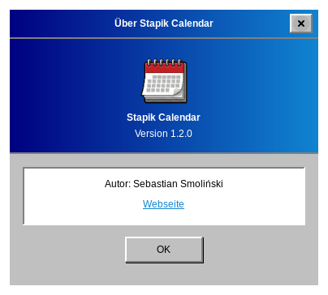

# Über die Anwendung

Wählen Sie **Hilfe → Info**, um Version und Autor zu sehen.

Quellcode und Problemmeldungen: [github.com/Stapik-Group/stapik-calendar](https://github.com/Stapik-Group/stapik-calendar). Der Synchronisierungsserver: [github.com/Stapik-Group/stapik-cloud](https://github.com/Stapik-Group/stapik-cloud).
