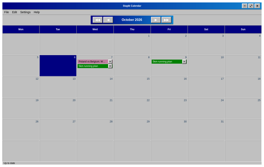

# Getting started

Stapik Calendar is a desktop calendar. It shows one month at a time, and every day can hold any number of **entries**. An entry has a name, an optional web link and an optional color.

Everything you do is saved automatically on your computer. If you have a Stapik Cloud server, the calendar can also be kept in sync between all your devices (see [Stapik Cloud synchronization](#cloud)).

A quick tour:

1. Start the application from your application menu (*Stapik Calendar*). It opens on the current month.
2. Double-click an empty area of any day.
3. Type a name and press **OK**. The entry appears in that day.
4. Right-click the entry to give it a color, drag it to another day to move it, or click **✕** to delete it.

