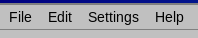

# The main window

From top to bottom the window consists of:

- **Menu bar** — *File*, *Edit*, *Settings* and *Help* (see [Menus](#menus)).
- **Navigation bar** — the name of the displayed month and year with buttons to change them.
- **Weekday header** — the seven days of the week. The week starts on the day set in the regional settings of your system (Monday in most European countries).
- **Week numbers** — the number of each week in the column to the left of the cells. They can be switched off in *Settings → Show week numbers*.
- **Day cells** — one cell per day. The number of the day is in the corner of its cell, and today is highlighted. Cells outside the displayed month stay empty.
- **Status bar** — shown only when the calendar is connected to a cloud; it tells you the synchronization state (see [Stapik Cloud synchronization](#cloud)).

