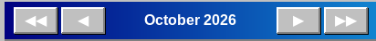

# Moving between months

The navigation bar has four buttons around the month name:

- ◀ — previous month
- ▶ — next month
- ◀◀ — previous year (same month)
- ▶▶ — next year (same month)

The month name between the buttons is a button too: click it to open a small calendar and jump straight to any month and year.

The **View** menu chooses what the calendar shows: **Month**, **Week** or **Day** (also `Ctrl`+`1`, `Ctrl`+`2`, `Ctrl`+`3`). The week view shows the seven days of the week of the selected day, the day view only the selected day. In these views the arrows ◀ and ▶ move by a week or by a day, and the buttons ◀◀ and ▶▶ still move by a year. The calendar starts in the month view.

The **Today** button next to the arrows brings you back to the current day. The day you clicked last is highlighted with a frame; moving between months keeps the same day of the month where possible.

The application always starts on the current month. Entries are kept for every month and year, there is no limit.

