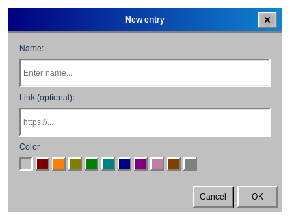
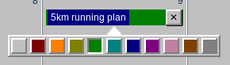
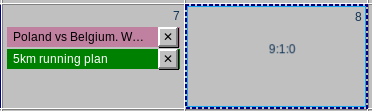
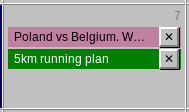

# Entries

## Adding an entry

Double-click an empty area of a day cell. The **New entry** window opens:

- **Name** — required. Without a name the entry is not created.
- **Link (optional)** — a web address that you can open later with one click.
- **Color** — the first, empty square means no color; the others are colors (see *Colors*).

Confirm with **OK**, or choose **Cancel** to discard.

## Quick add from the clipboard

If you copied a web address (starting with `http://` or `https://`), **right-click** a day. The application creates an entry for that day with the address as the link and the title of the web page as the name. This needs an internet connection; if the title cannot be read, the entry is named *No name*. When the clipboard does not contain a web address, nothing happens.

## Opening a link

When an entry has a link, a small link symbol (↗) appears at its right edge, next to the **✕** button. **Click the symbol** to open the link in your default browser. The mouse pointer turns into a hand over it, and pausing on it shows the address. Entries without a link have no symbol.

> Only `http` and `https` links are opened. A link typed without a scheme, such as `example.com`, is opened as `https://example.com`.

## Editing an entry

**Click the name of an entry** once to open the **Edit entry** window, where you can change the name, the link and the color.

## Deleting an entry

Click the **✕** button at the right edge of the entry. A deleted entry can be brought back with [Undo](#undo-redo).

## Colors

Right-click an entry to open a row of squares and click the color you want. You can also choose the color in the New entry and Edit entry windows. Available colors: red, orange, yellow, green, teal, blue, purple, pink, brown and gray, plus the default look with no color.

## Moving and copying

Drag an entry and drop it on another day to **move** it. Hold `Ctrl` while dragging to **copy** it instead. Dropping an entry on its own day changes nothing.

## Days with many entries

When a day has more entries than fit in its cell, the cell can be scrolled. Entries are listed in the order in which you added them.

