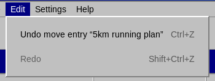

# Undo and redo

Adding, editing (including changing the color), deleting, moving and copying entries can all be undone. Use **Edit → Undo** and **Edit → Redo**, or the shortcuts `Ctrl`+`Z` and `Ctrl`+`Shift`+`Z`.

The menu item names the operation, for example *Undo delete entry “Dentist”*, and is grayed out when there is nothing to undo or redo. The history keeps up to 100 steps. It is not saved when you close the application, and it is cleared when the version from the cloud replaces your local calendar (see [Stapik Cloud synchronization](#cloud)).

