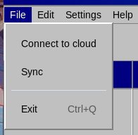
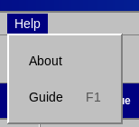

# Menus

**File**

- Connect to cloud — Opens the window for connecting to Stapik Cloud.
- Sync — Synchronizes with the cloud right now.
- Restore from backup… — Lists the saved copies of the calendar by date and time and goes back to the one you choose. What you had before becomes the newest copy, so the restore can be taken back the same way. The undo history is cleared and, when you are connected, the restored calendar is sent to the cloud.
- Exit `Ctrl`+`Q` — Closes the application. Pending changes are sent to the cloud first.

**Edit**

- Undo `Ctrl`+`Z` — Reverts the last operation.
- Redo `Ctrl`+`Shift`+`Z` — Repeats an operation that was undone.

**Settings**

- Settings… — Opens the settings window with the language (Polish, English or German), the theme and the font. A change is applied at once.

**Help**

- Tutorial `F1` — Opens this tutorial in a window with the contents on the left.
- View log — Shows the application log, which is useful when you report a problem.
- About — Shows the version and author of the application.

