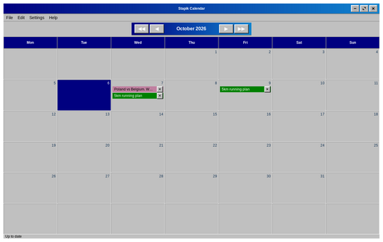
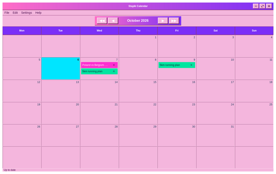
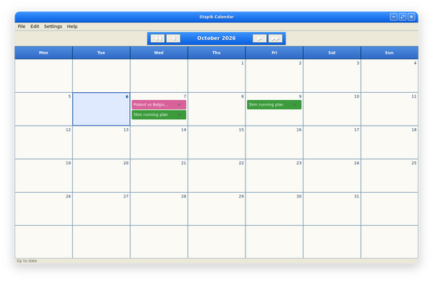
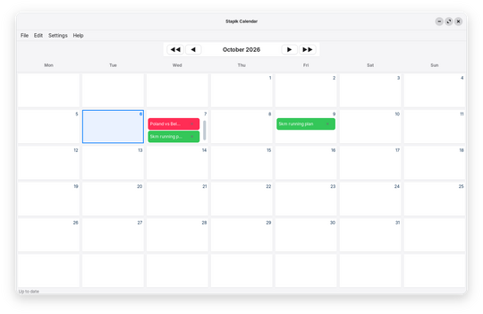
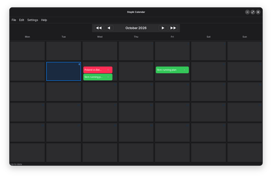

# Language and theme

Choose **Settings → Settings…** to open the settings window. Every change is applied and saved at once, and it is remembered the next time you start the application.

**Language** switches between Polish, English and German. The whole application changes immediately, including the names of the months and weekdays.

**Theme** changes the look: **Classic** (a retro look), **Classic Pink** (the same layout in pink and purple), **Neoclassic**, **Modern** (light) or **Dark**.

**Font** opens the font chooser for a font and its size (from 6 to 40 pt). The chosen font is used in the whole application, and the proportions between the text sizes of the theme are kept. The **Default** button goes back to the font of the theme.

