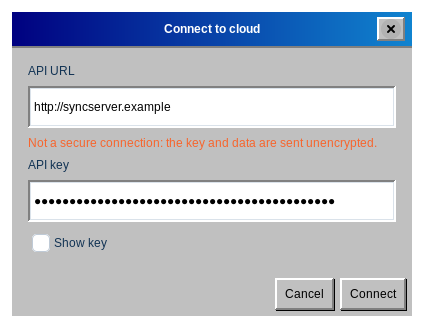
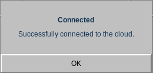

# Stapik Cloud synchronization

Stapik Cloud is a server that you run yourself. It keeps one copy of your calendar so that all your computers show the same entries. The cloud is optional — without it the calendar simply works on one computer.

## What you need

- A running Stapik Cloud server that your computer can reach, and its **address** (the API URL), for example `https://cloud.example.com`.
- An **API key** issued for this device. In the Stapik Cloud admin panel every device gets its own key; there is no shared key.

The calendar is stored on the server in separate partitions of the document, one per year (`2026`, `2027`…). The application downloads the year you are looking at, and the other years only when you move to them. A year without any entries does not create a partition in the cloud.

## Connecting

1. Choose **File → Connect to cloud**.
2. Enter the **API URL**. It must start with `http://` or `https://`.
3. Enter the **API key**. Tick **Show key** if you want to check what you typed.
4. Click **Connect**.
5. After a moment a message tells you whether the connection worked (*Connected*) or not (*Could not connect*, with the reason).

> If the address starts with `http://`, the window warns you that the connection is not secure: the key and your calendar are sent unencrypted. Use `https://` whenever the server is reachable over the internet.

The settings are remembered. Next time the application connects by itself, and the window you open from *Connect to cloud* is already filled in, so you can use it to change the server or the key.

**What happens at the first synchronization:** if the cloud is still empty, your calendar is uploaded. If the cloud copy of a year is newer than yours, it replaces that year on your computer. Otherwise your local year is uploaded.

**A calendar from earlier versions:** earlier versions of the application kept the whole calendar in one document, `calendar.json`. When you connect to a server for the first time, the application reads such a document once and adds its entries to the years on your computer (what you already have here stays). The old document in the cloud is not changed, but it is no longer updated either: earlier versions of the application on other devices still use it and do not see the partitions.

## The status bar

When a cloud is configured, the bottom of the window shows the current state:

- Up to date — Your calendar and the cloud are the same.
- Syncing… — A synchronization is in progress.
- Offline — The server cannot be reached. Your changes are safe on this computer, and the application retries by itself (first after 2 seconds, then less and less often, at most every 5 minutes).
- Conflict: server version kept — The cloud held a newer version, and it replaced your local one (see *Conflicts*).
- Sync error — The synchronization failed. Often retrying would not help, for example because the server rejected the API key, the encryption passphrase does not match or a year is too large for the server; a message then explains what to do. Local data is not affected.

## How synchronization works

- Every change is saved on your computer immediately.
- Sending to the cloud happens in the background, about 1.5 seconds after your last change, so the window never freezes. Several quick changes are sent together.
- When you close the application, any change that has not been sent yet is sent first.
- **File → Sync** synchronizes immediately.

## Conflicts and several devices

Each year is compared separately as one document, and the newer version wins. Entries are never merged one by one. If you change the calendar on two computers while both are offline, the version that reaches the server later replaces the other.

When the server version wins, it replaces the calendar on your computer and the undo history is cleared. By default Stapik Cloud keeps the replaced version in the document history, so it can be restored from the admin panel; restore it there and synchronize again.

If you change a year while it is being synchronized, a message tells you if your change was replaced by a newer version from the cloud. The version from before is among the backups (**File → Restore from backup…**).

> Tip for several devices: after you finish editing, wait for *Up to date* (or use *Sync*) before you switch to another computer.

## Changing the server or stopping synchronization

To use another server or key, open **File → Connect to cloud** again and enter the new values. To stop using the cloud, choose **File → Disconnect from cloud** and confirm. The address, the API key and the encryption passphrase are removed from this computer and the status bar disappears. Changes that are still waiting are sent first, which can take up to 3 seconds. Your local calendar and the calendar in the cloud are not affected, and you can connect again at any time.

The API key and the encryption passphrase are kept in the system keyring. Only when no keyring is available are they stored in `~/.config/stapikcalendar/config.json` in plain text, readable only by you; the application tells you so after connecting, so keep your home directory protected.

If the keyring cannot be read when the application starts (for example because it is locked), the application says so and does not connect. Unlock the keyring and restart the application, or enter the key again in **File → Connect to cloud**.
