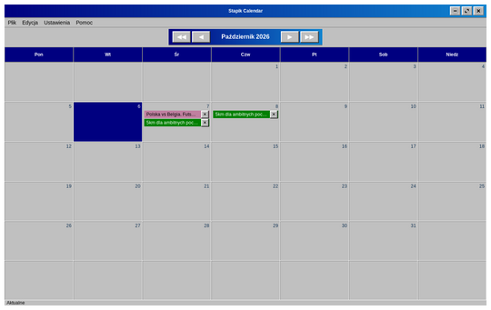

# Pierwsze kroki

Stapik Calendar to kalendarz na komputer. Pokazuje jeden miesiąc naraz, a każdy dzień może zawierać dowolną liczbę **wpisów**. Wpis ma nazwę, opcjonalny link do strony internetowej i opcjonalny kolor.

Wszystko, co robisz, jest zapisywane automatycznie na Twoim komputerze. Jeśli masz własny serwer Stapik Cloud, kalendarz może być też synchronizowany między wszystkimi Twoimi urządzeniami (zobacz [Synchronizacja ze Stapik Cloud](#cloud)).

Krótki przewodnik:

1. Uruchom aplikację z menu aplikacji (*Stapik Calendar*). Otworzy się na bieżącym miesiącu.
2. Kliknij dwukrotnie puste miejsce w dowolnym dniu.
3. Wpisz nazwę i naciśnij **OK**. Wpis pojawi się w tym dniu.
4. Kliknij wpis prawym przyciskiem myszy, aby nadać mu kolor, przeciągnij go na inny dzień, aby go przenieść, albo kliknij **✕**, aby go usunąć.

