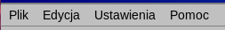

# Okno główne

Okno składa się, od góry, z:

- **Paska menu** — *Plik*, *Edycja*, *Ustawienia* i *Pomoc* (zobacz [Menu](#menus)).
- **Paska nawigacji** — nazwa wyświetlanego miesiąca i roku oraz przyciski do ich zmiany.
- **Nagłówka dni tygodnia** — siedem dni tygodnia. Tydzień zaczyna się w dniu ustawionym w ustawieniach regionalnych systemu (w Polsce i w większości krajów europejskich w poniedziałek).
- **Numerów tygodni** — numer każdego tygodnia w kolumnie po lewej stronie komórek. Można je wyłączyć w *Ustawienia → Pokazuj numery tygodni*.
- **Komórek dni** — jedna komórka na każdy dzień. Numer dnia jest w rogu komórki, a dzisiejszy dzień jest wyróżniony. Komórki spoza wyświetlanego miesiąca pozostają puste.
- **Paska stanu** — widoczny tylko wtedy, gdy kalendarz jest połączony z chmurą; pokazuje stan synchronizacji (zobacz [Synchronizacja ze Stapik Cloud](#cloud)).

