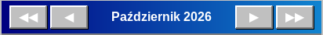

# Przechodzenie między miesiącami

Pasek nawigacji ma cztery przyciski wokół nazwy miesiąca:

- ◀ — poprzedni miesiąc
- ▶ — następny miesiąc
- ◀◀ — poprzedni rok (ten sam miesiąc)
- ▶▶ — następny rok (ten sam miesiąc)

Nazwa miesiąca między przyciskami jest też przyciskiem: kliknij ją, aby otworzyć mały kalendarz i przejść od razu do dowolnego miesiąca i roku.

Przycisk **Dziś** obok strzałek wraca do bieżącego dnia. Ostatnio kliknięty dzień jest podświetlony ramką; przechodząc między miesiącami, zachowujesz ten sam dzień miesiąca, o ile to możliwe.

Aplikacja zawsze uruchamia się na bieżącym miesiącu. Wpisy są zachowywane dla każdego miesiąca i roku, bez żadnego limitu.

