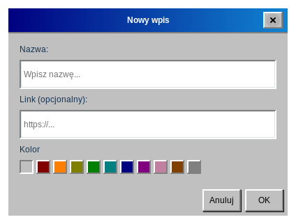
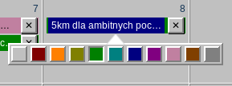
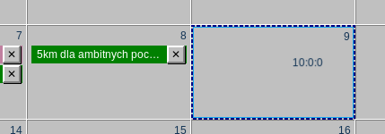
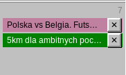

# Wpisy

## Dodawanie wpisu

Kliknij dwukrotnie puste miejsce w komórce dnia. Otworzy się okno **Nowy wpis**:

- **Nazwa** — wymagana. Bez nazwy wpis nie zostanie utworzony.
- **Link (opcjonalny)** — adres strony internetowej, który później otworzysz jednym kliknięciem.
- **Kolor** — pierwszy, pusty kwadracik oznacza brak koloru; pozostałe to kolory (zobacz *Kolory*).

Zatwierdź przyciskiem **OK** albo wybierz **Anuluj**, aby odrzucić.

## Szybkie dodawanie ze schowka

Jeśli skopiujesz adres strony (zaczynający się od `http://` lub `https://`), kliknij dzień **prawym przyciskiem myszy**. Od razu otworzy się okno **Nowy wpis** z adresem w polu **Link**, a aplikacja pobierze tytuł strony i wstawi go w pole **Nazwa**. Wymaga to połączenia z internetem; jeśli nie uda się odczytać tytułu, wpisz nazwę samodzielnie. Zatwierdź przyciskiem **OK**. Gdy w schowku nie ma adresu strony, nic się nie dzieje.

## Otwieranie linku

Gdy wpis ma link, przy jego prawej krawędzi, obok przycisku **✕**, pojawia się mały symbol linku (↗). **Kliknij ten symbol**, aby otworzyć link w domyślnej przeglądarce. Wskaźnik myszy zmienia się nad nim w rączkę, a po chwili zatrzymania pokazuje się adres. Wpisy bez linku nie mają symbolu.

> Otwierane są wyłącznie linki `http` i `https`. Link wpisany bez schematu, na przykład `example.com`, zostanie otwarty jako `https://example.com`.

## Edycja wpisu

**Kliknij nazwę wpisu** jeden raz, aby otworzyć okno **Edytuj wpis**, w którym możesz zmienić nazwę, link i kolor.

## Usuwanie wpisu

Kliknij przycisk **✕** przy prawej krawędzi wpisu. Usunięty wpis można przywrócić poleceniem [Cofnij](#undo-redo).

## Kolory

Kliknij wpis prawym przyciskiem myszy, aby otworzyć rząd kwadracików, i wybierz kolor. Kolor można też wybrać w oknach Nowy wpis i Edytuj wpis. Dostępne kolory: czerwony, pomarańczowy, żółty, zielony, morski, niebieski, fioletowy, różowy, brązowy i szary oraz wygląd domyślny bez koloru.

## Przenoszenie i kopiowanie

Przeciągnij wpis i upuść go na innym dniu, aby go **przenieść**. Przytrzymaj `Ctrl` podczas przeciągania, aby zamiast tego go **skopiować**. Upuszczenie wpisu na jego własnym dniu niczego nie zmienia.

## Dni z wieloma wpisami

Gdy dzień ma więcej wpisów, niż mieści się w komórce, komórkę można przewijać. Wpisy są wyświetlane w kolejności dodawania.

