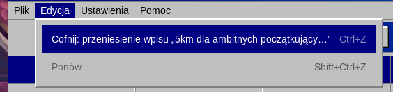

# Cofanie i ponawianie

Dodawanie, edycję (także zmianę koloru), usuwanie, przenoszenie i kopiowanie wpisów można cofnąć. Użyj **Edycja → Cofnij** i **Edycja → Ponów** albo skrótów `Ctrl`+`Z` i `Ctrl`+`Shift`+`Z`.

Pozycja menu podaje nazwę operacji, na przykład *Cofnij: usunięcie wpisu „Dentysta”*, i jest wyszarzona, gdy nie ma niczego do cofnięcia lub ponowienia. Historia obejmuje do 100 kroków. Nie jest zapisywana po zamknięciu aplikacji i jest czyszczona, gdy wersja z chmury zastąpi Twój lokalny kalendarz (zobacz [Synchronizacja ze Stapik Cloud](#cloud)).

