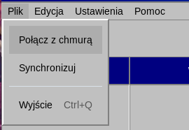
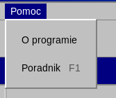

# Menu

**Plik**

- Połącz z chmurą — Otwiera okno łączenia ze Stapik Cloud.
- Synchronizuj — Synchronizuje z chmurą od razu.
- Odłącz od chmury — Kończy synchronizację i usuwa z tego komputera zapisany adres, klucz API i hasło. Dostępne tylko po połączeniu z chmurą.
- Przywróć z kopii zapasowej… — Pokazuje zapisane kopie kalendarza według daty i godziny i wraca do wybranej. To, co było wcześniej, staje się najnowszą kopią, więc przywrócenie można cofnąć w ten sam sposób. Historia cofania jest czyszczona, a po połączeniu z chmurą przywrócony kalendarz jest do niej wysyłany.
- Wyjście `Ctrl`+`Q` — Zamyka aplikację. Wcześniej wysyła do chmury oczekujące zmiany.

**Edycja**

- Cofnij `Ctrl`+`Z` — Cofa ostatnią operację.
- Ponów `Ctrl`+`Shift`+`Z` — Powtarza cofniętą operację.

**Widok**

- Miesiąc, Tydzień, Dzień `Ctrl`+`1`, `Ctrl`+`2`, `Ctrl`+`3` — Wybiera, czy kalendarz pokazuje cały miesiąc, jeden tydzień czy jeden dzień.
- Dziś — Przechodzi do bieżącego dnia.

**Ustawienia**

- Ustawienia… — Otwiera okno ustawień z językiem (polski, angielski lub niemiecki), motywem i czcionką. Zmiana działa od razu.

**Pomoc**

- Samouczek `F1` — Otwiera ten samouczek w osobnym oknie ze spisem treści po lewej.
- Podgląd dziennika — Pokazuje dziennik aplikacji, przydatny przy zgłaszaniu problemu.
- O programie — Pokazuje wersję i autora aplikacji.

