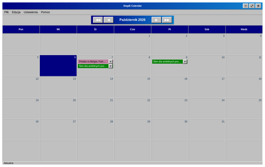
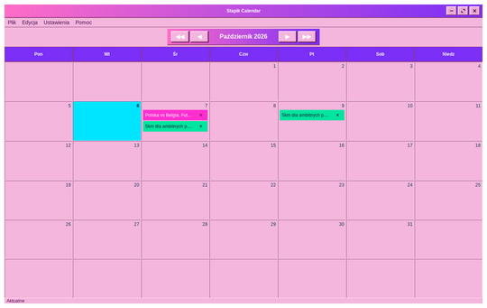
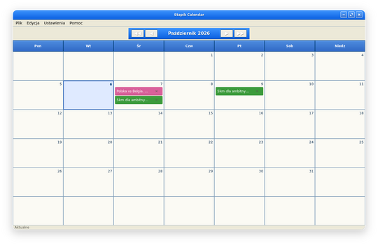
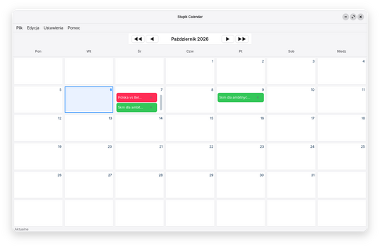
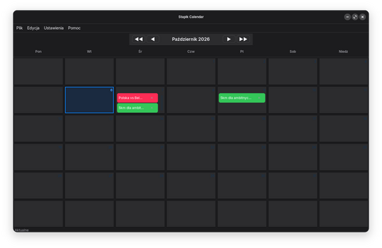

# Język i motyw

Wybierz **Ustawienia → Ustawienia…**, aby otworzyć okno ustawień. Każda zmiana działa i zapisuje się od razu, a przy kolejnym uruchomieniu aplikacji jest zapamiętana.

**Język** przełącza między polskim, angielskim i niemieckim. Cała aplikacja zmienia się od razu, razem z nazwami miesięcy i dni tygodnia.

**Motyw** zmienia wygląd: **Klasyczny** (retro), **Klasyczny różowy** (ten sam układ w różach i fioletach), **Neoklasyczny**, **Nowoczesny** (jasny) lub **Ciemny**.

**Rozmiar czcionki (%)** skaluje tekst całej aplikacji, od 70 % do 200 %. Domyślnie jest to 100 %.

