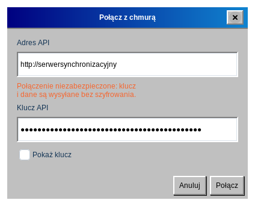
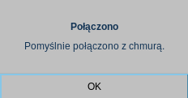
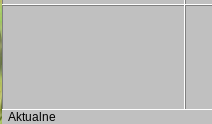

# Synchronizacja ze Stapik Cloud

Stapik Cloud to serwer, który uruchamiasz samodzielnie. Przechowuje jedną kopię Twojego kalendarza, dzięki czemu wszystkie Twoje komputery pokazują te same wpisy. Chmura jest opcjonalna — bez niej kalendarz po prostu działa na jednym komputerze.

## Czego potrzebujesz

- Działającego serwera Stapik Cloud, do którego Twój komputer ma dostęp, oraz jego **adresu** (adresu API), na przykład `https://cloud.example.com`.
- **Klucza API** wystawionego dla tego urządzenia. W panelu administracyjnym Stapik Cloud każde urządzenie dostaje własny klucz; nie ma klucza wspólnego.

Kalendarz jest przechowywany na serwerze w dokumencie o nazwie `calendar.json`.

## Łączenie

1. Wybierz **Plik → Połącz z chmurą**.
2. Wpisz **Adres API**. Musi zaczynać się od `http://` lub `https://`.
3. Wpisz **Klucz API**. Zaznacz **Pokaż klucz**, jeśli chcesz sprawdzić, co wpisałeś.
4. Kliknij **Połącz**.
5. Po chwili komunikat poinformuje, czy połączenie się udało (*Połączono*), czy nie (*Nie udało się połączyć*, wraz z przyczyną).

> Jeśli adres zaczyna się od `http://`, okno ostrzeże, że połączenie nie jest bezpieczne: klucz i kalendarz są wysyłane bez szyfrowania. Używaj `https://`, gdy serwer jest dostępny przez internet.

Ustawienia są zapamiętywane. Przy następnym uruchomieniu aplikacja łączy się sama, a okno otwierane z *Połącz z chmurą* jest już wypełnione, więc możesz go użyć do zmiany serwera lub klucza.

**Co dzieje się przy pierwszej synchronizacji:** jeśli chmura jest jeszcze pusta, Twój kalendarz zostaje wysłany. Jeśli kopia w chmurze jest nowsza od Twojej, zastępuje Twój lokalny kalendarz. W pozostałych przypadkach wysyłany jest Twój lokalny kalendarz.

## Pasek stanu

Gdy chmura jest skonfigurowana, u dołu okna widać bieżący stan:

- Aktualne — Twój kalendarz i chmura są takie same.
- Synchronizacja… — Trwa synchronizacja.
- Offline — Nie można połączyć się z serwerem. Twoje zmiany są bezpieczne na tym komputerze, a aplikacja ponawia próby sama (pierwszą po 2 sekundach, potem coraz rzadziej, najwyżej co 5 minut).
- Konflikt: zachowano wersję z serwera — W chmurze była nowsza wersja i zastąpiła Twoją lokalną (zobacz *Konflikty*).
- Błąd synchronizacji — Synchronizacja nie powiodła się z innego powodu, na przykład serwer odrzucił żądanie. Dane lokalne pozostają nienaruszone.

## Jak działa synchronizacja

- Każda zmiana jest od razu zapisywana na Twoim komputerze.
- Wysyłanie do chmury odbywa się w tle, około 1,5 sekundy po ostatniej zmianie, więc okno nigdy się nie zawiesza. Kilka szybkich zmian jest wysyłanych razem.
- Przy zamykaniu aplikacji najpierw wysyłana jest każda zmiana, która jeszcze nie trafiła do chmury.
- **Plik → Synchronizuj** synchronizuje od razu.

## Konflikty i kilka urządzeń

Cały kalendarz jest porównywany jako jeden dokument i wygrywa nowsza wersja. Wpisy nigdy nie są łączone pojedynczo. Jeśli zmienisz kalendarz na dwóch komputerach, gdy oba są offline, wersja, która później dotrze do serwera, zastąpi drugą.

Gdy wygrywa wersja z serwera, zastępuje kalendarz na Twoim komputerze, a historia cofania jest czyszczona. Domyślnie Stapik Cloud zachowuje zastąpioną wersję w historii dokumentu, więc można ją przywrócić z panelu administracyjnego; przywróć ją tam i zsynchronizuj ponownie.

> Wskazówka dla kilku urządzeń: po zakończeniu edycji poczekaj na stan *Aktualne* (albo użyj *Synchronizuj*), zanim przejdziesz na inny komputer.

## Zmiana serwera lub zakończenie synchronizacji

Aby użyć innego serwera lub klucza, otwórz ponownie **Plik → Połącz z chmurą** i wpisz nowe wartości. Nie ma przycisku rozłączania: aby przestać korzystać z chmury, zamknij aplikację i usuń plik `~/.config/stapikcalendar/config.json`. Twój lokalny kalendarz nie zostanie naruszony.

Klucz API jest zapisany w tym pliku jawnym tekstem i odczytać go możesz tylko Ty, więc dbaj o ochronę swojego katalogu domowego.
