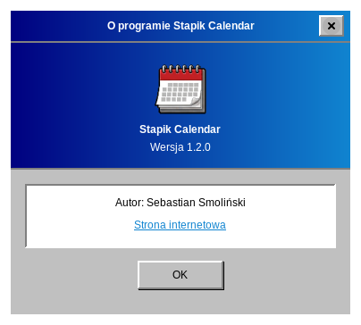

# O programie

Wybierz **Pomoc → O programie**, aby zobaczyć wersję i autora.

Kod źródłowy i zgłaszanie problemów: [github.com/Stapik-Group/stapik-calendar](https://github.com/Stapik-Group/stapik-calendar). Serwer synchronizacji: [github.com/Stapik-Group/stapik-cloud](https://github.com/Stapik-Group/stapik-cloud).
